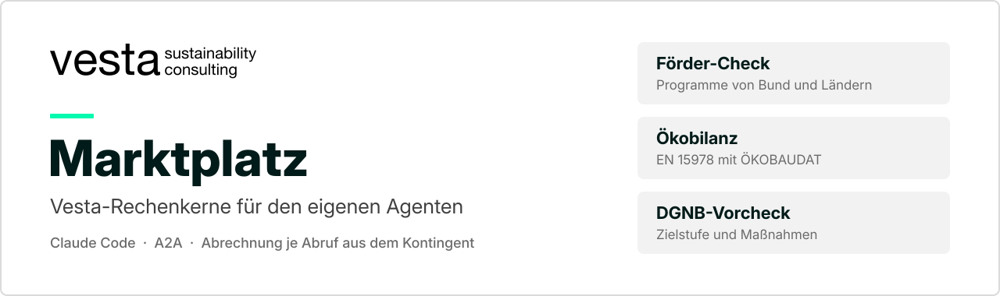
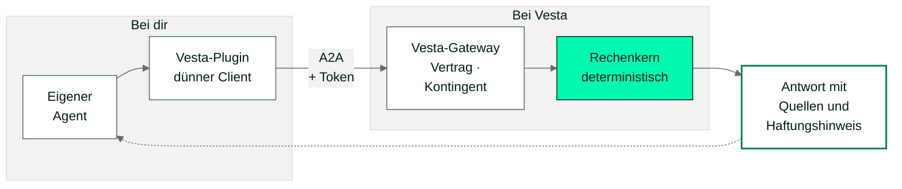

<p align="center">
  
</p>

# Vesta Marktplatz

Vesta stellt drei Rechenkerne als Dienste bereit: den Förder-Check, die Ökobilanz nach DIN EN 15978 mit ÖKOBAUDAT und den DGNB-Vorcheck. Dein eigener Agent ruft sie direkt auf, über das offene Agent2Agent-Protokoll (A2A). Abgerechnet wird je Abruf, aus dem Kontingent deines Rahmenvertrags.

Dieses Repo ist der Marktplatz für Claude Code. Für jeden Dienst gibt es ein Plugin: eine Anleitung für deinen Agenten und ein kleines Skript, das die Anfrage an Vesta schickt. Gerechnet wird bei Vesta; Server-Code, Datenbestände und Tokens enthält dieses Repo nicht.

| Dienst | Frage | Ergebnis |
|---|---|---|
| [Förder-Check](#förder-check) | Welche Förderprogramme passen zu meinem Vorhaben? | Programme von Bund und Ländern, Kumulierung, Förderhöhe, soweit bezifferbar |
| [Ökobilanz](#ökobilanz-quick-check) | Wie hoch ist das Treibhauspotenzial des Gebäudes? | Kennwert in kg CO₂-Äq./(m²·a), Bilanz je Modul, HTML-Report |
| [DGNB-Vorcheck](#dgnb-vorcheck) | Ist die DGNB-Zielstufe erreichbar? | Erfüllungsgrad, erreichte Stufe, Maßnahmen nach Wirkung sortiert |

## So bindest du es ein

Du brauchst [Claude Code](https://code.claude.com/docs) und [uv](https://docs.astral.sh/uv/); uv lädt Python und die Abhängigkeiten der Skripte selbst. Den Token (Format `vesta-frame-…`) bekommst du von Vesta mit dem Rahmenvertrag.

**1. Marktplatz hinzufügen**

```
/plugin marketplace add vesta-consult/marketplace
```

**2. Plugin installieren.** Jeder Dienst ist ein eigenes Plugin, du installierst nur, was du brauchst:

```
/plugin install vesta-foerder-check@vesta
/plugin install vesta-quick-check@vesta
/plugin install vesta-dgnb-precheck@vesta
```

**3. Token hinterlegen**, einmal je Plugin:

```
/vesta-foerder-check:setup <token>
/vesta-quick-check:setup <token>
/vesta-dgnb-precheck:setup <token>
```

Der Token liegt danach in deinem Benutzerordner unter `~/.config/vesta/`, lesbar nur für dich. In den Projektordner kommt er nicht.

Jetzt fragst du im Chat in normaler Sprache. Der Agent erkennt den passenden Dienst, fragt fehlende Angaben nach und ruft Vesta auf. Welche Dienste dein Token freischaltet und wie groß das Kontingent ist, regelt der Rahmenvertrag.

**Ohne Claude Code.** Der Vesta-Endpunkt spricht A2A, sodass jeder A2A-fähige Agent ihn mit Token direkt aufrufen kann. Endpunkt und Nachrichtenformat stehen in den Client-Skripten unter `vesta-*/scripts/`. Für claude.ai, die Claude-Desktop-App und andere Assistenten stimmen wir die Anbindung je Vertrag ab.

## Die Dienste

### Förder-Check

Plugin `vesta-foerder-check` · [README](vesta-foerder-check/README.md)

Der Förder-Check prüft, welche Förderprogramme von Bund und Ländern für ein Vorhaben in Frage kommen, wie sie sich kombinieren lassen und wie hoch die Förderung grob ausfällt. Grundlage ist ein Bestand an Programmen, deren Werte an der Primärquelle geprüft sind (Richtlinie, Merkblatt, Gesetz). Programme, die bekannt, aber noch nicht geprüft sind, führt er getrennt als Hinweis.

| Eingabe | Ausgabe |
|---|---|
| Freitext. Der Agent bildet daraus ein Profil: Zielgruppe, Assetklasse, Ebene (Gebäude, Quartier, Portfolio), Vorhaben (z. B. Neubau, Sanierung, Heizung), Bundesland | Passende Programme mit Förderart und Förderhöhe, soweit bezifferbar · Kumulierung · Quellen · ausgeschlossene Programme mit Grund · Haftungshinweis · Dashboard als HTML im Projektordner, mit 3D-Modell des Gebäudes, wenn eines vorliegt oder sich laden lässt |

**Beispielfrage**

> Welche Förderung gibt es für einen Projektentwickler, der in Bayern ein Wohngebäude mit 55 Wohnungen neu baut?

**Ergebnis** (echter Abruf vom 08.11.2026, anonymisiert und gekürzt)

```text
Förder-Check abgeschlossen. 3 Programme kommen in Frage.
Profil:  projektentwickler · wohngebaeude · gebaeude · neubau · by
Geprüft: 33 Programme

1  Degressive AfA bei Wohngebäuden (§ 7 Abs. 5a EStG)          Steuer · Bund
   5 % vom jeweiligen Restwert. Wirkung hängt vom Steuersatz ab,
   nicht in Euro bezifferbar.

2  Sonderabschreibung Mietwohnungsneubau (§ 7b EStG)           Steuer · Bund
   Bis zu 5 % p. a. im Herstellungsjahr und in den drei Folgejahren.
   Baukostenobergrenze 5.200 €/m² Wohnfläche,
   Bemessungsgrundlage höchstens 4.000 €/m² Wohnfläche.

3  Klimafreundlicher Neubau Wohngebäude (KFN, KfW 297/298)     Kredit · Bund
   Kredithöchstbetrag 100.000 € je Wohneinheit, mit QNG 150.000 €.
   Vorteil ist die Zinsverbilligung, nicht in Euro bezifferbar.
   Quelle: KFN-Richtlinie Nr. 5.3.2

Zusätzlich bekannt, nicht verifiziert: 2 Landesprogramme Bayern
Nicht in Frage (Auszug): BEG WG und BEG EM (decken Neubau nicht ab),
                         BEG NWG (nur Nichtwohngebäude)

Haftungshinweis (Kurzfassung, wörtlich):
Unverbindliche Orientierung — keine Förder-/Rechts-/Steuerberatung, keine
Gewähr; Haftung ausgeschlossen, soweit gesetzlich zulässig. Vor Antrag
Primärquelle und Sign-off prüfen.
```

Zur Einordnung, geprüft an Gesetz und Richtlinie am 07.11.2026: § 7b EStG setzt unter anderem ein Effizienzhaus 40 mit QNG-Siegel und zehn Jahre Vermietung voraus. Bei gewerblichen Einkünften gilt die De-minimis-Grenze von 300.000 € in drei Jahren. Die KFN-Beträge sind Höchstbeträge: 100.000 € je Wohneinheit bei Effizienzhaus 40 mit eingehaltener THG-Grenze nach QNG-PLUS, 150.000 €, wenn zusätzlich ein QNG-Zertifikat vorliegt. Die Förderung steht unter dem Vorbehalt verfügbarer Bundesmittel.

### Ökobilanz (Quick-Check)

Plugin `vesta-quick-check` · [README](vesta-quick-check/README.md)

Der Quick-Check berechnet die Ökobilanz eines Gebäudes nach DIN EN 15978 mit Datensätzen aus der ÖKOBAUDAT: Herstellung (A1–A3), Ersatz (B4), Betrieb (B6), Entsorgung (C3, C4), Modul D getrennt ausgewiesen. Das Plugin liest Bauteile und Mengen auf deinem Rechner aus dem IFC-Modell und ergänzt die Betriebsenergie aus dem Energiekonzept. An Vesta geht nur diese strukturierte Akte, das IFC-Modell bleibt bei dir. Fehlen Angaben, listet der Agent sie auf und sendet nichts.

| Eingabe | Ausgabe |
|---|---|
| Projektordner mit IFC-Modell und Energiekonzept, bei Bedarf Bauteilliste. Daraus baut der Agent die Akte: Netto-Nutzfläche, Betrachtungszeitraum, Bauteile mit Schichten, Material und Menge, Endenergie je Energieträger | Kennwert in kg CO₂-Äq. je m² NFA und Jahr · Bilanz je Modul · Bauteile mit den verwendeten ÖKOBAUDAT-Datensätzen · weitere Indikatoren nach EN 15804+A2 · HTML-Report |

**Beispielfrage**

> Mach den Vesta-Quick-Check für dieses Projekt.

**Ergebnis** für das Beispielprojekt in [`vesta-quick-check/examples/`](vesta-quick-check/examples/) (Report vom 05.06.2026, gekürzt)

```text
Kennwert  24,27 kg CO₂-Äq./(m² NFA · a)      NFA 120 m² · Betrachtungszeitraum 50 a

Modul    Bedeutung                     GWP kg CO₂-Äq.   Anteil
A1–A3    Herstellung                            4.294    2,9 %
B4       Ersatz im Lebenszyklus                 1.395    1,0 %
B6       Betrieb (Energie über 50 a)          139.200   95,6 %
C3       Abfallbehandlung                         706    0,5 %
C4       Beseitigung                                0    0,0 %
         Summe ohne D (EN 15978)              145.595  100,0 %
D        Gutschriften, getrennt                   −69
```

Weil das Beispielprojekt nur ein Bauteil enthält (eine Außenwand), überwiegt hier der Betrieb.

### DGNB-Vorcheck

Plugin `vesta-dgnb-precheck` · [README](vesta-dgnb-precheck/README.md)

Der Vorcheck schätzt früh in der Planung, ob eine DGNB-Stufe (Silber, Gold, Platin) erreichbar ist, und ordnet die Maßnahmen nach ihrem Beitrag zum Erfüllungsgrad. Die Kriterien und ihre Gewichtung sind bei Vesta hinterlegt. Ohne eigene Punkte-Einschätzung rechnet der Vorcheck vom Nullpunkt und zeigt alles, was für die Zielstufe zu tun ist.

| Eingabe | Ausgabe |
|---|---|
| Zielstufe (Pflicht), Nutzungsprofil (derzeit Wohngebäude), optional geschätzte Punkte je Kriterium (0 bis 100) | Gesamterfüllungsgrad und Erfüllungsgrad je Qualität · erreichte Stufe · Zielstufe erreichbar ja oder nein · Maßnahmenkatalog, größter Hebel zuerst · noch nicht bewertete Kriterien · Haftungshinweis · Zusammenfassung als HTML |

**Beispielfrage**

> Wir planen ein Wohngebäude und wollen DGNB Gold erreichen. Ist das machbar, und was müssen wir dafür tun?

## Wie es funktioniert



1. Du stellst die Frage in deinem Agenten.
2. Das Plugin macht daraus eine strukturierte Anfrage. Fehlt eine Angabe, die das Ergebnis verändert, fragt der Agent nach, statt zu raten.
3. Das Vesta-Gateway prüft Token und Rahmenvertrag, bucht den Abruf vom Kontingent und protokolliert ihn.
4. Der Rechenkern rechnet deterministisch und ohne generatives Sprachmodell: Dieselbe Eingabe ergibt immer dasselbe Ergebnis.
5. Die Antwort kommt mit Quellen und Haftungshinweis zurück. Dein Agent bereitet sie auf und gibt den Haftungshinweis vollständig wieder.

## Datenschutz

- An Vesta geht nur die strukturierte Anfrage: beim Förder-Check das Profil, Projekt-ID und Projektname und, falls vorhanden, das 3D-Modell des Gebäudes mit seiner Lage (ohne Adresse), beim Quick-Check die Akte mit Bauteilen, Mengen und Energiewerten, beim DGNB-Vorcheck Zielstufe, Profil und gegebenenfalls Punkte. Personenbezogene Daten braucht keiner der Dienste.
- IFC-Modelle und Projektdokumente bleiben auf deinem Rechner. Die Auswertung läuft dort.
- Für das 3D-Modell beim Förder-Check geht die Adresse an OpenStreetMap Nominatim und an den Download-Server des Landes, nicht an Vesta.
- Die Rechenkerne laufen auf Servern von Vesta in Deutschland. Jeder Abruf wird protokolliert, das ist die Grundlage der Abrechnung.
- Frage und Antwort laufen auch über deinen Chat-Anbieter, bei Claude über Anthropic. Dafür gelten dessen Bedingungen und eure eigenen Regeln.
- Dieses Repo enthält keinen Server-Code, keine Datenbestände und keine Tokens. Deinen Token committest du nie in ein Projekt-Repo.

## Haftung

Alle Dienste liefern eine unverbindliche, automatisierte Orientierung. Sie ersetzen keine Förder-, Rechts-, Steuer- oder Fachberatung und keine Zertifizierung. Jede Antwort trägt ihren eigenen Haftungshinweis.

- **Förder-Check:** keine Zusage einer Förderung. Werte vor dem Antrag an der Primärquelle prüfen.
- **Ökobilanz:** Orientierung für Planung und Variantenvergleich, kein Nachweis für QNG oder eine Zertifizierung.
- **DGNB-Vorcheck:** Prognose. Verbindlich bewertet nur die DGNB-Zertifizierungsstelle.

## Aufbau des Repos

```text
.claude-plugin/marketplace.json   Katalog der Plugins (Marktplatz „vesta“)
vesta-foerder-check/              Förder-Check
vesta-quick-check/                Ökobilanz, mit Beispielprojekt unter examples/
vesta-dgnb-precheck/              DGNB-Vorcheck
assets/                           Banner und Logo
```

Jedes Plugin enthält `skills/` (Anleitung für den Agenten), `commands/setup.md` (Token hinterlegen) und `scripts/` (Client für den Abruf).

## Kontakt

**vesta sustainability consulting**, München
Hannes Harter · hannes.harter@vesta-consult.de · [vesta-consult.de](https://vesta-consult.de)

Rahmenvertrag, Kontingent, Pilot oder Anbindung an andere Assistenten: schreib uns.
